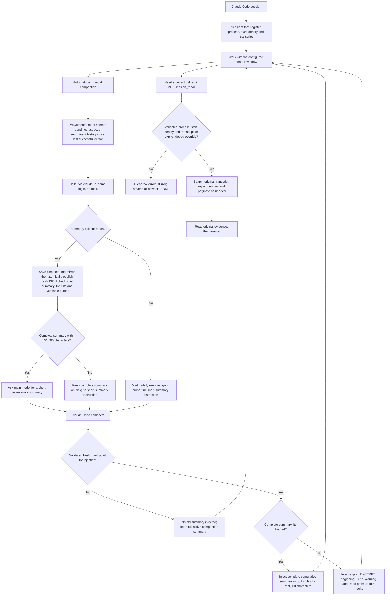

# claude-contextmanagement

[Português](README.pt-BR.md)

A Claude Code plugin for long sessions. It lets you cap the context window (for example at 270k tokens) and retain more history through a cumulative summary and transcript recall. In our small test, quality was close to a 1M-token session; this is not a guarantee of lossless memory. It works on a normal Claude subscription (Pro or Max) and needs no API key.

> **Provided as is.** This is an experiment shared in case it is useful. There is no warranty, and no promise of maintenance, support, review of issues or pull requests, or compatibility with future Claude Code versions. Read the code before you install it. See [LICENSE](LICENSE).

## Why

With a 1M-token window, every turn of a long session re-reads the whole history. That is slow and uses a lot of your quota. If you cap the window, Claude Code compacts more often, and its default compaction keeps only a short summary (about 6k tokens in our test). Old details are lost, and answers about early decisions get worse.

This plugin changes what happens at each compaction:

1. **A cheap model writes the long summary.** Before each compaction, Haiku (through the same `claude` login) reads a serialized version of the messages since the last successful checkpoint plus the last good summary, and writes a new cumulative summary. Tool results are shortened for this step; exact details remain searchable in the transcript. The complete `.md` mirror is saved first; only then is a fresh JSON checkpoint published atomically with the last good summary and a verifiable transcript cursor. If the mirror cannot be saved, the checkpoint is not published as ready. A pending or failed attempt does not advance that cursor: the next attempt reprocesses from the last success, not the last compaction.
2. **A fresh summary comes back into context, within a bounded budget.** Only a validated, fresh checkpoint can supply injected history. If the complete summary fits the conservative 51,600-character budget, the main model is asked for a short recent-work summary, and hooks inject the complete cumulative summary after compaction. A larger summary stays complete on disk, but injection is an explicit **EXCERPT** with its beginning and end, a warning and a path to read the full file with `Read`; the end includes the tail of the file lists when it fits. In this overflow case, the plugin does not request a short native summary. Pending or failed attempts inject no old summary and leave the full native compaction summary in place.
3. **Exact old facts come from the transcript.** A small MCP server adds the `session_recall` tool. It does a literal search (no model) over the original session transcript, including tool results that were compacted away. The model is told to search and read the original text before it states an old number, name, date or decision. Recall requires a registry record validated against the process, its start identity and the transcript; it never falls back to the newest JSONL file. Without a valid record it returns a clear tool error (`isError`), unless an explicit `RECALL_TRANSCRIPT` debugging override is set.

## How it works



The summary keeps the thread of the work; `session_recall` recovers the evidence. Summarization does not replace the original transcript.

**Scope and boundaries:**

- The context window is a Claude Code setting, not a limit enforced by the plugin. With `270000`, compaction was observed near 240k tokens; the value is not an exact compaction trigger.
- The Haiku call is synchronous: compaction waits for the hook. This plugin does not implement background summarization, tool-result offloading, or a separate retained-recent-token budget.
- The summarizer receives shortened tool results (2,000 characters each), not a lossless copy of the history. File lists track the supported tool calls, not every possible filesystem change made through a shell or another tool.
- Injection uses at most six hooks of 9,600 characters, with a conservative 51,600-character budget for a complete summary. Larger summaries remain complete on disk, but only a labelled beginning/end excerpt returns automatically; use the supplied path with `Read` for the full text. Overflow leaves the full native summary in place rather than requesting a short one. This is bounded, selective memory, not lossless memory.
- The atomic JSON checkpoint is the source of truth for freshness and the last successful cursor. The `.md` file is a readable mirror at the compatible path, not enough on its own to prove freshness. Pending or failed attempts do not reinject the old summary; the next attempt starts from the last successful checkpoint.
- Recall fails clearly when no process/start-identity/transcript-validated registration is available; it does not guess from the newest JSONL or an unidentified ancestor process. Automatic association recognizes native `claude`/`claude.exe` and the official Node CLI on Linux/macOS through its arguments. Windows npm/Node launchers without safe detection leave the association unavailable and require explicit `RECALL_TRANSCRIPT`. This fail-closed behavior favors session isolation over automatic discovery.

All script paths in the table below are relative to [`plugins/context-manager/`](plugins/context-manager/).

| Part | File | What it does |
| --- | --- | --- |
| `PreCompact` hook | `scripts/precompact_summary.py` | Serializes the messages since the last successful checkpoint (tool results cut at 2,000 characters), adds the last good summary, and calls `claude -p --model haiku` with no tools. The summary has a fixed structure (goal, constraints, progress, decisions, next steps, critical context) and rules that put the user's own words first and copy names, numbers, ids, paths and errors exactly. The output budget is 15,000 tokens per response; continued responses are joined. The hook appends the cumulative list of files read and modified (`Read`, `Write`, `Edit`, `NotebookEdit`), then saves the complete readable `.md` mirror before atomically publishing the fresh JSON checkpoint with the summary and verifiable cursor. If saving the mirror fails, the checkpoint is not marked ready. Pending or failed attempts preserve the last good checkpoint for retry, not stale injection. Failure or a summary over 51,600 characters prints no short-summary instruction, so Claude Code keeps its full native compaction summary. |
| `SessionStart` hook (matcher `compact`) | `scripts/inject_summary.py` | Validates checkpoint freshness before injecting history in up to 6 parts of 9,600 characters, because Claude Code caps each hook's output at 10,000 characters. A complete summary fits within a conservative 51,600-character budget; larger summaries produce an explicit beginning/end EXCERPT with a warning and the full file's `Read` path, not silent truncation. Pending or failed attempts inject no old text. |
| `SessionStart` hook | `scripts/register_session.py` | Records the running Claude Code process, its start identity and transcript, so `session_recall` can validate the association before reading a file. |
| MCP server `recall` | `scripts/recall_mcp.py` | `session_recall` with `action: search` (exact phrase first, then entries with most of the words, ignoring case and accents; each hit shows the matching line centred on the match, with its neighbours) and `action: expand` (reads entries by id; a long entry comes in 10,000-character pages through `offset` and `next_offset`). Requires a validated process/start-identity/transcript registry record or explicit `RECALL_TRANSCRIPT` override; otherwise returns `isError`, never the newest JSONL as a fallback. |

Data (JSON checkpoints, readable summary mirrors, the session registry and a log) is kept in the plugin data folder, `~/.claude/plugins/data/context-manager-claude-contextmanagement/`.

## Requirements

- Claude Code, logged in, with `claude` on your `PATH`.
- `python3` 3.9 or newer. No extra packages.
- Linux, macOS or Windows. The hooks and the recall server start Python directly, with no shell, so Windows does not need Git Bash for them. Automatic session association is fail-closed: native `claude`/`claude.exe` is recognized, as is the official Node CLI on Linux/macOS when its arguments identify the Claude Code CLI path. Windows npm/Node launchers without safe detection require an explicit `RECALL_TRANSCRIPT`; otherwise recall reports that the association is unavailable rather than guessing. The full flow (install, compaction, summary, recall) was tested on Linux with a logged-in Claude Code. The scripts are tested on Linux, macOS and Windows in CI, with Python 3.9 and 3.13 and a stand-in for `claude`, because CI has no Claude login.

## Install

```bash
claude plugin marketplace add joaovitor2763/claude-contextmanagement
claude plugin install context-manager@claude-contextmanagement --config python=python3
```

The `python` option is the command that starts Python 3. Use `python3` on macOS and Linux. On Windows, use `python` or `py` (the `python3` entry that Windows adds opens the Microsoft Store when Python came from python.org). A full path also works. If you install from the `/plugin` screen instead, it asks for this value. To change it later, run `/plugin configure context-manager@claude-contextmanagement`. Without it, the hooks do not run.

A plugin cannot set environment variables, so set the window yourself in `~/.claude/settings.json`:

```json
{ "env": { "CLAUDE_CODE_AUTO_COMPACT_WINDOW": "270000" } }
```

With 270000, compaction runs at about 240k tokens. Accepted values are 100000 to 1000000. To try it in one session only: `CLAUDE_CODE_AUTO_COMPACT_WINDOW=270000 claude`.

Open a new session. `/plugin` should list `context-manager` as enabled, and `/mcp` should show the `recall` server as connected.

## Check that it works

1. In a session with some history, run `/compact`. A manual compaction runs the same hooks.
2. Read the last log line:

   ```bash
   tail -n 1 ~/.claude/plugins/data/context-manager-claude-contextmanagement/log.jsonl
   ```

   `"ok": true` means the summarizer wrote the summary. `secs` is how long the compaction waited for it.
3. The complete, readable summary is in `.../summaries/<session_id>.md` in the same folder. Its presence alone does not mean it was fresh enough to inject: freshness comes from the atomic JSON checkpoint. If injection says EXCERPT, read that file with `Read` to recover the full summary.
4. Ask about an exact old fact. The model should call `session_recall` before it answers. Without a validated session registration (or an explicit debugging override), expect a clear tool error rather than recall from another session.

## Options

| Variable | Default | Use |
| --- | --- | --- |
| `CCM_SUMMARY_MODEL` | `haiku` | The model that writes the cumulative summary (`haiku`, `sonnet`, or a full model id). |
| `CCM_ENV_FILE` | empty | Only if you log in through an environment variable (CI, containers with `CLAUDE_CODE_OAUTH_TOKEN`). Hooks do not receive that variable, so point this at a `KEY=value` file that has it. Not needed with a normal browser login. |
| `RECALL_TRANSCRIPT` | empty | Forces the transcript that `session_recall` reads. Explicit debugging override of registry-based selection. |
| `CCM_MAX_OUTPUT_TOKENS` | `15000` | Output budget per summarizer response. If Claude Code continues a capped response, the hook joins the parts; this is not a cap on the final summary's characters or total tokens. |

Uninstall: `claude plugin uninstall context-manager@claude-contextmanagement`, and remove `CLAUDE_CODE_AUTO_COMPACT_WINDOW` from your settings.

## Results

We compared three setups in Claude Code 2.1.327 with Opus 5.5 on a Max subscription, in November 2026:

- **1M:** the default 1M-token window.
- **Native 270k:** `CLAUDE_CODE_AUTO_COMPACT_WINDOW=270000`, with Claude Code's own compaction.
- **Plugin 270k:** the same window with this plugin.

| | 1M (2 runs) | Native 270k (1 run) | Plugin 270k (2 runs) |
| --- | --- | --- | --- |
| Recall of old facts | 92% | 91% | 94% |
| Task score (0 to 100) | 59.8 | 44.2 | 57.8 |
| API-equivalent cost per recall question | $0.35 | $0.13 | $0.12 |
| API-equivalent cost per task | $0.23 | $0.10 | $0.12 |
| Time per recall question | 14.2 s | 23.6 s | 9.6 s |
| Time per task | 23.2 s | 21.5 s | 17.8 s |
| Tokens read per task | 776k | 43k | 176k |
| Wait per compaction | | 47 to 81 s | 47 to 114 s |

**What this shows:**

- The plugin is close to 1M on quality at about half the cost per task and a third of the cost per recall question. The differences from 1M are within noise: tasks −1.9 points (95% CI −12 to +8), recall +2.6 points (−10 to +15).
- Against native compaction at the same window, the plugin scores +13.6 points on tasks (−3 to +32). The interval still includes zero.
- The plugin is faster per answer than both. Each compaction waits about as long as native or a bit longer, because Haiku reads the new history first.
- The summarizer is cheap: the four Haiku calls of a session cost $0.68 to $1.02 API-equivalent (29k to 48k output tokens), against about $14 for the whole replay.

**How we measured:**

- Three real work sessions of about 775k tokens each, in Portuguese (business analysis, code and data work). They are private and not published.
- Each session was replayed into Claude Code in eight parts, so each setup compacted as it would in use. After the replay, 16 prompts were forked from the same point: 8 questions about exact old facts (with an answer key) and 8 work tasks (with a rubric). That gives 24 questions and 24 tasks per setup per run.
- Two blind judges (Claude Sonnet 5.5 and Grok 4.7) scored the answers. Recall is the mean of the two judges' scores against the answer key. A task criterion counts only when both judges agree. All setups were judged together.
- Costs are the `total_cost_usd` that Claude Code reports, which is an API-equivalent price. On a subscription you pay in quota instead. One run of the plugin and one of 1M on all three sessions used about 5 points of the weekly Max quota.

**Limits:**

- Three sessions and two runs are a small sample. The same prompt in the same setup moved by 17 to 20 task points on average between runs. Treat the numbers as an indication, not a benchmark.
- The 1M setup did not stay at 1M: resuming a session of about 775k tokens made Claude Code compact automatically to about 400k, whatever the window setting. Real sessions that grow turn by turn may behave differently.
- In the second plugin run, 2 of 12 compactions hit the 15k output cap, and an earlier version kept only the last part of the summary. That version is fixed: the hook now joins every part (tested with a forced low cap). The table includes the affected run.
- All sessions were in Portuguese, and only Opus 5.5 was tested as the main model.

## Credits

The summary structure is adapted from the compaction prompt of [pi-coding-agent](https://github.com/earendil-works/pi) by Mario Zechner (MIT).

## License

MIT. See [LICENSE](LICENSE). Provided as is, without warranty and without any expectation of maintenance.
