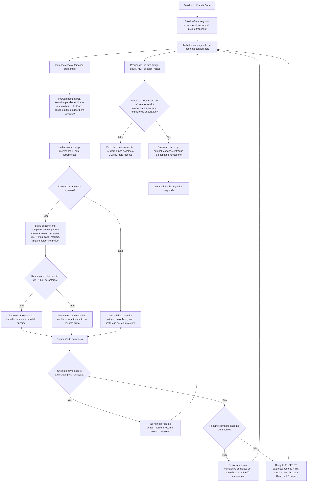

# claude-contextmanagement

[English](README.md)

Plugin do Claude Code para sessões longas. Com ele, você limita a janela de contexto (por exemplo, a 270 mil tokens) e preserva mais histórico com um resumo cumulativo e busca no transcript. No nosso teste pequeno, a qualidade ficou próxima de uma sessão de 1 milhão de tokens; isso não garante memória sem perdas. Funciona na assinatura normal do Claude (Pro ou Max), sem chave de API.

> **Fornecido "como está" (as is).** É um experimento, compartilhado caso seja útil. Não há garantia de nenhum tipo, nem compromisso de manutenção, suporte, revisão de issues ou pull requests, ou compatibilidade com versões futuras do Claude Code. Leia o código antes de instalar. Veja a [LICENSE](LICENSE).

## Por quê

Com janela de 1M, cada turno de uma sessão longa relê o histórico inteiro. Isso é lento e consome muito da sua cota. Com uma janela menor, o Claude Code compacta mais vezes, e a compactação padrão guarda só um resumo curto (cerca de 6 mil tokens no nosso teste). Os detalhes antigos se perdem, e as respostas sobre decisões antigas pioram.

O plugin muda o que acontece em cada compactação:

1. **Um modelo barato escreve o resumo longo.** Antes de cada compactação, o Haiku (pelo mesmo login do `claude`) lê uma versão serializada das mensagens desde o último checkpoint bem-sucedido, mais o último resumo bom, e escreve um resumo cumulativo novo. Os resultados de ferramenta são encurtados nessa etapa; os detalhes exatos continuam pesquisáveis no transcript. O espelho `.md` completo é salvo primeiro; só depois um checkpoint JSON atualizado é publicado atomicamente com o último resumo bom e um cursor verificável do transcript. Se o espelho não puder ser salvo, o checkpoint não é publicado como pronto. Uma tentativa pendente ou falha não avança esse cursor: a próxima reprocessa desde o último sucesso, não desde a última compactação.
2. **Um resumo atualizado volta ao contexto, dentro de um orçamento limitado.** Só um checkpoint validado e atualizado pode fornecer histórico para reinjeção. Se o resumo completo couber no orçamento conservador de 51.600 caracteres, o modelo principal é orientado a escrever um resumo curto do trabalho recente, e os hooks reinjetam o resumo cumulativo completo após a compactação. Um resumo maior continua completo no disco, mas a reinjeção é um **EXCERPT** explícito com começo e fim, aviso e caminho para ler o arquivo completo com `Read`; o fim inclui a cauda das listas de arquivos quando couber. Nesse caso de overflow, o plugin não pede resumo nativo curto. Tentativas pendentes ou falhas não reinjetam o resumo antigo e mantêm o resumo completo da compactação nativa.
3. **Fatos antigos exatos vêm do transcript.** Um servidor MCP pequeno acrescenta a ferramenta `session_recall`. Ela faz uma busca literal (sem modelo) no transcript original da sessão, inclusive em resultados de ferramenta já compactados. O modelo é orientado a buscar e ler o trecho original antes de afirmar um número, nome, data ou decisão antiga. O recall exige um registro validado contra o processo, sua identidade de início e o transcript; nunca usa o JSONL mais recente como fallback. Sem registro válido, retorna um erro claro da ferramenta (`isError`), salvo quando há um override explícito de depuração em `RECALL_TRANSCRIPT`.

## Como funciona



O resumo mantém o fio do trabalho; o `session_recall` recupera a evidência. A sumarização não substitui o transcript original.

**Escopo e limites:**

- A janela é uma configuração do Claude Code, não um teto imposto pelo plugin. Com `270000`, observou-se compactação perto de 240 mil tokens; o valor não é um gatilho exato de compactação.
- A chamada ao Haiku é síncrona: a compactação espera o hook. Este plugin não implementa resumo em segundo plano, offload de resultados de ferramenta nem um orçamento separado de tokens recentes preservados.
- O resumidor recebe resultados de ferramenta encurtados (2.000 caracteres cada), não uma cópia sem perdas do histórico. As listas de arquivos rastreiam as chamadas de ferramentas suportadas, não toda mudança possível feita por shell ou outra ferramenta.
- A reinjeção usa no máximo seis hooks de 9.600 caracteres, com orçamento conservador de 51.600 caracteres para um resumo completo. Resumos maiores continuam completos no disco, mas só um trecho identificado de começo e fim volta automaticamente; use o caminho informado com `Read` para ler o texto completo. O overflow mantém o resumo nativo completo, sem pedir um curto. É memória limitada e seletiva, não memória sem perdas.
- O checkpoint JSON atômico é a fonte de verdade para saber se o resumo está atualizado e qual é o último cursor bem-sucedido. O `.md` é um espelho legível no caminho compatível, insuficiente sozinho para comprovar atualização. Tentativas pendentes ou falhas não reinjetam o resumo antigo; a próxima tentativa parte do último checkpoint bem-sucedido.
- O recall falha claramente quando não há registro validado por processo, identidade de início e transcript; não adivinha pelo JSONL mais recente nem por um processo ancestral não identificado. A associação automática reconhece `claude`/`claude.exe` nativo e o CLI oficial em Node no Linux/macOS pelos argumentos. Launchers npm/Node no Windows sem detecção segura deixam a associação indisponível e exigem `RECALL_TRANSCRIPT` explícito. Esse comportamento fail-closed prioriza o isolamento entre sessões, não a descoberta automática.

Os caminhos dos scripts na tabela abaixo são relativos a [`plugins/context-manager/`](plugins/context-manager/).

| Parte | Arquivo | O que faz |
| --- | --- | --- |
| Hook `PreCompact` | `scripts/precompact_summary.py` | Serializa as mensagens desde o último checkpoint bem-sucedido (resultados de ferramenta cortados em 2.000 caracteres), junta o último resumo bom e chama `claude -p --model haiku` sem ferramentas. O resumo tem estrutura fixa (objetivo, restrições, progresso, decisões, próximos passos, contexto crítico) e regras que dão prioridade às palavras da pessoa e copiam nomes, números, ids, caminhos e erros exatamente. O orçamento de saída é de 15.000 tokens por resposta; as continuações são concatenadas. O hook acrescenta a lista cumulativa de arquivos lidos e modificados (`Read`, `Write`, `Edit`, `NotebookEdit`), salva primeiro o espelho `.md` completo e legível, antes de publicar atomicamente o checkpoint JSON atualizado com o resumo e o cursor verificável. Se a gravação do espelho falhar, o checkpoint não é marcado como pronto. Tentativas pendentes ou falhas preservam o último checkpoint bom para nova tentativa, não para reinjeção desatualizada. Falha ou resumo acima de 51.600 caracteres não imprime instrução de resumo curto, então o Claude Code mantém seu resumo nativo completo. |
| Hook `SessionStart` (matcher `compact`) | `scripts/inject_summary.py` | Valida se o checkpoint está atualizado antes de reinjetar histórico em até 6 partes de 9.600 caracteres, porque o Claude Code limita a saída de cada hook a 10.000 caracteres. Um resumo completo cabe no orçamento conservador de 51.600 caracteres; resumos maiores geram um EXCERPT explícito com começo e fim, aviso e caminho do arquivo completo para `Read`, sem truncamento silencioso. Tentativas pendentes ou falhas não reinjetam texto antigo. |
| Hook `SessionStart` | `scripts/register_session.py` | Registra o processo do Claude Code em execução, sua identidade de início e o transcript, para o `session_recall` validar a associação antes de ler um arquivo. |
| Servidor MCP `recall` | `scripts/recall_mcp.py` | `session_recall` com `action: search` (frase exata primeiro, depois as entradas com mais palavras, sem diferenciar maiúsculas e acentos; cada acerto mostra a linha centrada no termo, com as vizinhas) e `action: expand` (lê entradas por id; uma entrada longa vem em páginas de 10.000 caracteres, com `offset` e `next_offset`). Exige registro validado por processo, identidade de início e transcript ou override explícito em `RECALL_TRANSCRIPT`; caso contrário retorna `isError`, nunca o JSONL mais recente como fallback. |

Os dados (checkpoints JSON, espelhos legíveis dos resumos, registro de sessões e log) ficam na pasta de dados do plugin, `~/.claude/plugins/data/context-manager-claude-contextmanagement/`.

## Requisitos

- Claude Code com login feito e `claude` no `PATH`.
- `python3` 3.9 ou mais novo, sem pacotes extras.
- Linux, macOS ou Windows. Os hooks e o servidor de recall abrem o Python direto, sem shell, então o Windows não precisa do Git Bash para eles. A associação automática da sessão é fail-closed: reconhece `claude`/`claude.exe` nativo e o CLI oficial em Node no Linux/macOS quando os argumentos identificam o caminho do CLI do Claude Code. Launchers npm/Node no Windows sem detecção segura exigem `RECALL_TRANSCRIPT` explícito; sem ele, o recall informa que a associação está indisponível em vez de adivinhar. O fluxo completo (instalação, compactação, resumo e recall) foi testado no Linux, com o Claude Code logado. Os scripts são testados no Linux, no macOS e no Windows pelo CI, com Python 3.9 e 3.13 e um substituto do `claude`, porque o CI não tem login no Claude.

## Instalação

```bash
claude plugin marketplace add joaovitor2763/claude-contextmanagement
claude plugin install context-manager@claude-contextmanagement --config python=python3
```

A opção `python` é o comando que abre o Python 3. Use `python3` no macOS e no Linux. No Windows, use `python` ou `py` (o `python3` que o Windows cria abre a Microsoft Store quando o Python veio do python.org). Um caminho completo também funciona. Se você instalar pela tela do `/plugin`, ela pede esse valor. Para trocar depois, rode `/plugin configure context-manager@claude-contextmanagement`. Sem ele, os hooks não rodam.

Um plugin não define variável de ambiente. Defina a janela no `~/.claude/settings.json`:

```json
{ "env": { "CLAUDE_CODE_AUTO_COMPACT_WINDOW": "270000" } }
```

Com 270000, a compactação acontece perto de 240 mil tokens. O valor aceito vai de 100000 a 1000000. Para testar numa sessão só: `CLAUDE_CODE_AUTO_COMPACT_WINDOW=270000 claude`.

Abra uma sessão nova. O `/plugin` deve mostrar o `context-manager` ativo, e o `/mcp` deve mostrar o servidor `recall` conectado.

## Como conferir

1. Numa sessão com algum histórico, rode `/compact`. A compactação manual passa pelos mesmos hooks.
2. Leia a última linha do log:

   ```bash
   tail -n 1 ~/.claude/plugins/data/context-manager-claude-contextmanagement/log.jsonl
   ```

   `"ok": true` diz que o resumo foi escrito. `secs` é quanto a compactação esperou por ele.
3. O resumo completo e legível fica em `.../summaries/<session_id>.md`, na mesma pasta. Sua presença sozinha não significa que estava atualizado para reinjeção: isso depende do checkpoint JSON atômico. Se a reinjeção indicar EXCERPT, leia esse arquivo com `Read` para recuperar o resumo completo.
4. Pergunte por um fato antigo e exato. O modelo deve chamar o `session_recall` antes de responder. Sem registro validado da sessão (ou override explícito de depuração), o esperado é um erro claro da ferramenta, não recall de outra sessão.

## Opções

| Variável | Padrão | Uso |
| --- | --- | --- |
| `CCM_SUMMARY_MODEL` | `haiku` | Modelo que escreve o resumo cumulativo (`haiku`, `sonnet` ou um id completo). |
| `CCM_ENV_FILE` | vazio | Só para login por variável de ambiente (CI, containers com `CLAUDE_CODE_OAUTH_TOKEN`). Os hooks não recebem essa variável: aponte para um arquivo `CHAVE=valor` que a tenha. Com login normal pelo navegador, não precisa. |
| `RECALL_TRANSCRIPT` | vazio | Força o transcript que o `session_recall` lê. Override explícito de depuração para a seleção pelo registro de sessões. |
| `CCM_MAX_OUTPUT_TOKENS` | `15000` | Orçamento por resposta do resumidor. Se o Claude Code continuar uma resposta que atingiu o limite, o hook junta as partes; isso não limita os caracteres nem o total de tokens do resumo final. |

Para remover: `claude plugin uninstall context-manager@claude-contextmanagement`, e tire `CLAUDE_CODE_AUTO_COMPACT_WINDOW` das configurações.

## Resultados

Comparamos três configurações no Claude Code 2.1.327, com o Opus 5.5 numa assinatura Max, em novembro de 2026:

- **1M:** a janela padrão de 1 milhão de tokens.
- **Nativo 270k:** `CLAUDE_CODE_AUTO_COMPACT_WINDOW=270000`, com a compactação do próprio Claude Code.
- **Plugin 270k:** a mesma janela, com este plugin.

| | 1M (2 rodadas) | Nativo 270k (1 rodada) | Plugin 270k (2 rodadas) |
| --- | --- | --- | --- |
| Lembrança de fatos antigos | 92% | 91% | 94% |
| Nota das tarefas (0 a 100) | 59,8 | 44,2 | 57,8 |
| Custo equivalente em API por pergunta de lembrança | US$ 0,35 | US$ 0,13 | US$ 0,12 |
| Custo equivalente em API por tarefa | US$ 0,23 | US$ 0,10 | US$ 0,12 |
| Tempo por pergunta de lembrança | 14,2 s | 23,6 s | 9,6 s |
| Tempo por tarefa | 23,2 s | 21,5 s | 17,8 s |
| Tokens lidos por tarefa | 776 mil | 43 mil | 176 mil |
| Espera por compactação | | 47 a 81 s | 47 a 114 s |

**O que isso mostra:**

- O plugin chega perto do 1M em qualidade, com cerca de metade do custo por tarefa e um terço do custo por pergunta de lembrança. As diferenças para o 1M ficam dentro do ruído: tarefas −1,9 ponto (IC 95% de −12 a +8) e lembrança +2,6 pontos (−10 a +15).
- Contra a compactação nativa na mesma janela, o plugin faz +13,6 pontos nas tarefas (−3 a +32). O intervalo ainda inclui zero.
- O plugin responde mais rápido que os outros dois. Cada compactação espera quase o mesmo que a nativa, ou um pouco mais, porque o Haiku lê o histórico novo antes.
- O resumidor é barato: as quatro chamadas ao Haiku de uma sessão custaram de US$ 0,68 a US$ 1,02 equivalentes em API (29 a 48 mil tokens de saída), contra cerca de US$ 14 da reprodução inteira.

**Como medimos:**

- Três sessões reais de trabalho, com cerca de 775 mil tokens cada, em português (análise de negócio, código e dados). Elas são privadas e não estão publicadas.
- Cada sessão foi reproduzida no Claude Code em oito partes, para cada configuração compactar como no uso real. Depois, 16 prompts saíram do mesmo ponto (fork): 8 perguntas sobre fatos antigos exatos, com gabarito, e 8 tarefas de trabalho, com rubrica. São 24 perguntas e 24 tarefas por configuração em cada rodada.
- Dois juízes cegos (Claude Sonnet 5.5 e Grok 4.7) deram as notas. A lembrança é a média das notas dos dois contra o gabarito. Um critério da rubrica só conta quando os dois concordam. Todas as configurações foram julgadas juntas.
- O custo é o `total_cost_usd` que o Claude Code informa, um preço equivalente ao da API. Na assinatura, o gasto vira cota. Uma rodada do plugin e uma do 1M nas três sessões usaram cerca de 5 pontos da cota semanal do Max.

**Limites:**

- Três sessões e duas rodadas são uma amostra pequena. O mesmo prompt, na mesma configuração, variou em média de 17 a 20 pontos de tarefa entre rodadas. Leia os números como indicação, não como benchmark.
- O braço de 1M não ficou em 1M: retomar uma sessão de cerca de 775 mil tokens fez o Claude Code compactar sozinho para uns 400 mil, qualquer que fosse a janela. Sessões reais, que crescem turno a turno, podem se comportar de outro jeito.
- Na segunda rodada do plugin, 2 de 12 compactações bateram no teto de 15 mil tokens de saída, e uma versão anterior guardava só a última parte do resumo. Essa versão foi corrigida: o hook agora junta todas as partes (testado com um teto baixo forçado). A tabela inclui a rodada afetada.
- Todas as sessões eram em português, e só o Opus 5.5 foi testado como modelo principal.

## Créditos

A estrutura do resumo foi adaptada do prompt de compactação do [pi-coding-agent](https://github.com/earendil-works/pi), de Mario Zechner (MIT).

## Licença

MIT. Veja a [LICENSE](LICENSE). Fornecido "como está", sem garantia e sem expectativa de manutenção.
